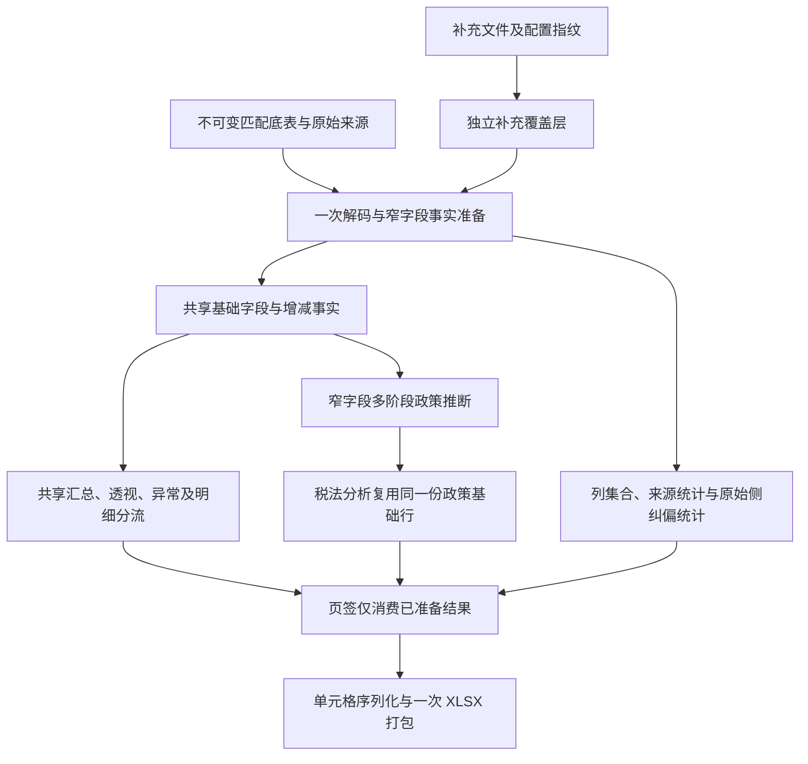

# FA 导出底层重复计算审计（2026-10-26）

以下保留整改前的完整调用链审计作为基线。2026-10-26 已实施政策结果共享、窄输入回放、列／来源统计共享及补充差量写入，详情见末尾整改记录；尚未实施所有页签共享事实与不可变底表的整体重构。此前探针直接调用 `write_xlsx_with_progress`，不经过完整 `fa.export`，不能用于判断完整导出是否接近优化上限。

## 结论

存在架构层面的重复工作。当前缓存保存的是匹配行，而不是一次计算后可由各页签共享的资产事实和分析结果。多个页签仍各自回源；在磁盘模式中，每次遍历会重新读取并反序列化整条 `JoinedRow` JSON。缓存命中减少了重新配对，并没有消除后续的重复读取、字段解析与业务计算。

优先级最高的改造应是：不可变匹配底表与补充数据分离；一次形成可复用的窄字段事实；共享中间分析及统计；页签消费已有结果。压缩和单元格写出只能解释剩余成本的一部分。

## 当前完整调用链与全表遍历

整改前基线固定为：命中有效磁盘快照、输出 XLSX、没有补充配置、不生成 LLM 分析页、资源预算允许且正常完成。N 表示 `joined` 的行数。只统计会解码完整匹配 JSON 的遍历，不将 SQL COUNT、寿命统计元数据或有限前部取样混入 N。

| 顺序 | 步骤 | 匹配行完整遍历 | 证据 |
| --- | --- | ---: | --- |
| 1 | 快照加载后逐行验证 | 1N | `fa_merge_snapshot.rs:433` 中复制工作库，`:443` 消费全部 `rows.iter()` |
| 2 | 应用补充：即使无配置仍清理／查询／写回全部匹配行 | 1N，另有 N 次 UPDATE | `fa_disk.rs:503` 无条件调用 `edit_disk_rows`；`fa_disk_rows.rs:174` 重新序列化并 UPDATE |
| 3 | 为税法分析生成折旧期间基础数据 | 3N | `fa.rs:2102` 调用 `build_depreciation_period`；该函数 `:5277`、`:5306`、`:5334` 三次执行 `inputs()` |
| 4 | 收集输出列及补充字段并集 | 1N | `fa.rs:3614` 调用 `result_columns`，`:3378` 中扫描 extra 键 |
| 5 | 写合并明细 | 1N | `fa.rs:3690`；另有不计入全表次数的前部数值取样 |
| 6 | 透视统计 | 1N | `fa.rs:5588` 的 `build_pivot` |
| 7 | 固定资产变动汇总 | 1N | `fa.rs:4088` 的 `build_summary_lines_with_sources` |
| 8 | FA List、新增、处置 | 3N | `fa.rs:4459`、`:4576`、`:4697` 各自重新遍历；短寿命子集已在上一轮改为复用 |
| 9 | 折旧期间页写入前再次生成基础数据 | 3N | `fa_subtools.rs:891` 再次调用 `fa::build_depreciation_period` |
| 10 | 异常清单 | 1N | `fa.rs:4855` |
| 11 | 完成前重新统计匹配行来源 | 1N | `fa.rs:2143` → `match_statistics` |
| 12 | 完成前仅为返回列数，再收集一遍全部输出列 | 1N | `fa.rs:2144` → `result_columns` |
| 合计 | 上述指定成功分支 | **18N** | 静态调用路径计数，不是计时或运行时探针计数 |

另外还有 `correction_warnings` 对期初和期末 `source` 的完整扫描（`fa.rs:5111`），逐行 JSON 解码并复制源行。它们不是 joined 的两遍 N：原始两侧行数与外连接／重复键处理后的 N 不同，应单独统计。

启用补充配置时，收集 valid 匹配键再增加 1N；生成 LLM 分析页时，`build_analysis_facts` 再增加 1N。首次无快照、快照损坏回退、提前取消／失败、CSV、资源保护等分支不适用上面的固定计数。

以已有 291,148 行匹配结果为例，18N 对应约 524 万次匹配行 JSON 解码，还没有算原始两侧 source、有限取样和补充分支。不能用“整个 SQLite 文件大小 ×18”当成物理 IO：该库还包含其他表，而且操作系统／SQLite 缓存会影响实际读盘量。

## 已确认的重复与必要依赖

### 1. 同一折旧期间结果确实计算了两遍

`export` 先计算 `period_rows`，将它交给税法类别分析；`write_depreciation_period_tax_sheet` 又从原始匹配结果重新生成同样的基础行，再按序追加税法列。基础行已经存在，应当复用，而不是重新调用生成器。

此重复即使税法 LLM 关闭也存在：默认税法分析仍返回分析对象，写表路径仍会再算基础行。独立的“折旧政策对比”同样受影响：`fa_subtools.rs:643` 先生成 `policy_rows`，之后同一写表函数再次生成。

函数内部三阶段有真实的全局依赖：先确定期初类别／寿命集合，再建立期初到期末的映射，最后按回填规则分组。因此不能直接删掉两阶段或改成只检查一条 ID。可以把第一次读取时得到的窄字段输入保存下来，后两阶段仅回放这些输入，而不是重复解析整行 JSON、数字、寿命、残值和类别。

### 2. 补充数据通过“修改整份匹配结果”叠加

`fa_disk::apply_supplements` 不论配置是否为空，都会执行最后的 `edit_disk_rows`。每行准备并查询两条补充 SQL，然后重新序列化整行并 UPDATE；即使值没有变化也写回。

无补充配置时，两张新建的补充表为空，仍然执行这些查询。291,148 行对应约 873,444 次“两个 SELECT 加一个 UPDATE”，还不包含批次读取及其他 SQL。这是静态语句数量，不是已测出的时间占比。

不能无条件删除这段：历史快照可能带着旧补充字段，移除／替换补充配置时必须清理。正确方向是纯匹配底表不可变，补充数据作为独立覆盖表，或者至少记录补充指纹和字段存在状态、只更新变化行。

快照加载当前先复制整个 SQLite 再修改它。已见真实快照为 3,528,949,760 字节（约 3.5 GB）。不可变底表加独立覆盖层还可以研究消除这份工作库复制，但必须同时重新设计 `DiskLease` 生命周期：它目前会在最后一个持有者释放时删除所持有的库，绝不能直接让它拥有用户的缓存原件。

### 3. 页签边界变成了读取和计算边界

FA List、新增、处置、汇总、透视、异常和文字分析分别扫描并处理同一批资产，重复提取类别、原值、累计折旧、寿命、残值、日期及增减额。各页签的最终口径不同，但这些基础事实不需要分别解析和计算。

可以在一次资产事实遍历中同时更新不同汇总器，并将明细分流到不同的有界临时结果。必须保留各自的过滤规则、顺序、分母、合计／小计处理、处置公式行号和补充优先级，不能把“共享基础数据”误做成“所有页签用同一个过滤口径”。

### 4. 输出元数据没有随计算结果一起保存

`result_columns` 计算过后，又仅为返回列数重扫一遍；匹配来源统计也没有作为可复用统计进入导出上下文。它们应在同一趟准备过程中累计并保存。

纠偏警告应在原始两侧读取／规范化时累计。不能简单从 joined 重新计数替代：重复键保留／聚合和外连接会改变行数，警告统计需要保持原始源行口径。

## 建议的结构改造

目标是减少完整宽行的重复解码和基础事实重算，不是声称整套业务只允许一个循环。全局推断仍需多阶段，工作簿每张表的单元格仍需实际写出。

建议改造顺序：

1. 引入明确的 `ExportContext`／已准备结果对象，生命周期贯穿完整 `fa.export`。先把政策基础行、输出列、来源统计的生产者和消费者接到同一对象，消除确定的整段重算。
2. 定义窄字段资产事实和有界存储；首次宽行读取时完成字段索引绑定、数字／日期／寿命／残值解析，保留原始值与来源标识。规模大时落 SQLite 实体列或其他有界存储，不把 29 万行所有宽字段强行装进内存。
3. 将多页签的计算入口改成消费共享事实，能合并的聚合在同一遍更新；政策推断只回放已解析的窄输入。写表函数不再自行访问完整匹配底表。
4. 拆分不可变匹配数据和补充覆盖层，完善指纹失效及旧补充清理，再消除整库复制／整表 UPDATE。不要先删安全校验或直接把缓存原件交给会删除文件的对象。

### 失效与安全边界

- 基础事实至少随输入文件身份、Sheet／标题行、匹配键／重复策略、字段映射及规则版本变化而失效。
- 补充覆盖层还要跟踪补充文件身份、工作表、键及字段映射；移除、替换和源文件内容变化都必须正确生效。
- 表日、透视配置、展示口径、税法配置等属于依赖它们的分析／渲染层，不能因复用中间结果而沿用旧设置。
- 保留全量损坏检测、原有快照回退及取消语义。可以让首次验证同时生产共享事实，避免验证后丢弃再读取；不能用抽样替代完整结果所需的验证。

## 新验收方式

- 从完整 `fa.export` 及 `policy_export` 入口计数各阶段的宽行解码、源行读取、UPDATE 与基础事实生成次数；已有写表器基准继续作为子阶段证据，不再代表完整导出。
- 覆盖快照命中／损坏、无补充、相同补充、替换／移除补充、开启／关闭税法与分析页、映射／表日变化、内存／磁盘、取消及尾部错误。
- 逐页签核对行数、数值类型、金额、排序、来源说明、公式及其缓存、异常与纠偏警告；关键产物做 XML 对照。共享基础事实不能改变不同页签的既有业务口径。
- 验收同时报告完整流程耗时和解码／更新计数，不用局部压缩加速百分比推算整体收益。

## 2026-10-26 已实施的整改与边界

- 政策基础行从税法分析、写表分别生成改为共享 `PreparedPolicyExport`；政策内部三阶段只首遍读取宽行，后两遍回放有界的八字段窄输入。因此这部分完整宽行解码由 6N 降为 N，保留全局推断及浮点位模式。
- 输出列与来源统计一次准备，主入口的 XLSX／CSV 与完成消息复用，去掉原完成阶段的 2N。
- 补充仍需检查历史字段，保留 N 清理扫描；空配置不再做 2N 条空查询，无变化行不序列化、不 UPDATE；有配置也只更新变化行。工作库复制和旧数据检测保留。
- 按上表同一固定分支，剩余静态计数为 **11N**，另有有限取样及两侧 source 警告统计。完整快照命中导出回归直接计数（小样本的前部取样覆盖全部行，因而是 12N），并逐工作表比较数据与公式。
- 扩展修复其他入口：独立政策对比复用上述准备结果；FA TB＋JE 的汇总、对方科目透视及辅助勾稽每任务各构建一次；TS 两种透视共享输入列与数值解析。源码与验证范围见 `EXPORT_PERFORMANCE_AUDIT.md`。
- 尚存的多页签回源、基础事实统一、快照复制和原始侧警告读取没有包装成已完成；无全流程 18→1 或固定加速倍数承诺。回归证据见 `artifacts/export-unification-20261026/`。
